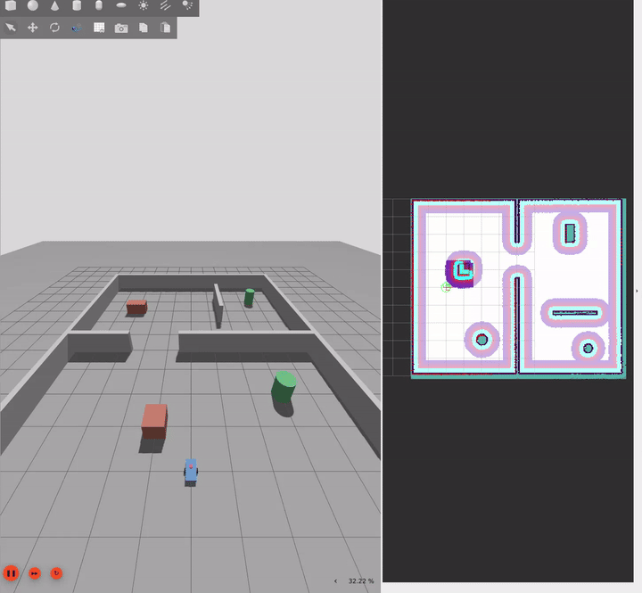
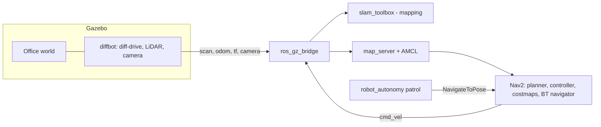
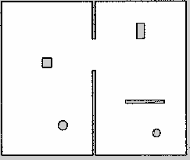

# ROS 2 Mobile Robot Navigation

[](https://github.com/MariaFlp/ros2-mobile-nav/actions/workflows/ci.yml)


A differential-drive robot that maps an unknown environment with **slam_toolbox**, localizes with **AMCL**,
and navigates autonomously with **Nav2** in a custom Gazebo world. Everything runs from one Docker image.

<!-- Replace with your recording: docs/images/demo.gif -->


## What it does

- Simulates a differential-drive robot (URDF/Xacro) with a 360° LiDAR and an RGB camera in Gazebo Harmonic
- Builds a map of a two-room office with `slam_toolbox` and saves it for reuse
- Localizes on the saved map (AMCL) and plans/follows paths through doorways with Nav2
- Runs a waypoint patrol mission and logs success, duration and recoveries for every goal

## Architecture



## Repository layout

```
src/
  robot_description/   URDF/Xacro model, sensors, Gazebo plugins, RViz config
  robot_gazebo/        Office world, ROS-Gazebo bridge config, simulation launch
  robot_slam/          slam_toolbox configuration and launch
  robot_navigation/    Nav2 configuration, saved map, navigation launch
  robot_autonomy/      Waypoint patrol mission with per-goal CSV logging
tools/                 World generator, Nav2 parameter patch script
results/               Mission logs
```

## Quick start

Requires Docker and an X11/XWayland desktop.

```bash
git clone https://github.com/MariaFlp/ros2-mobile-nav.git && cd ros2-mobile-nav
docker build -t ros2-nav:jazzy .
./run.sh                                  # opens a shell inside the container
```

Inside the container:

```bash
colcon build --symlink-install && source install/setup.bash

# Terminal 1: simulation
ros2 launch robot_gazebo sim.launch.py rviz:=false

# Terminal 2 (open with ./shell.sh on the host): navigate on the saved map
ros2 launch robot_navigation navigation.launch.py

# Terminal 3: patrol the office
ros2 run robot_autonomy patrol --ros-args -p use_sim_time:=true
```

To build a new map instead: launch the simulation, run `ros2 launch robot_slam slam.launch.py`
**before moving the robot**, drive with `ros2 run teleop_twist_keyboard teleop_twist_keyboard`, then save it with
`ros2 run nav2_map_server map_saver_cli -f /ws/src/robot_navigation/maps/office`.



## Results

First patrol of the five waypoints, starting from the spawn pose (simulation time):

| Waypoint | Result | Duration (s) | Recoveries |
|---|---|---|---|
| doorway_east | succeeded | 13.7 | 0 |
| east_room_north | succeeded | 8.1 | 0 |
| east_room_south | succeeded | 19.6 | 0 |
| west_room | succeeded | 25.5 | 0 |
| home | succeeded | 7.6 | 0 |

5/5 goals succeeded with no recovery behaviours. Raw logs are in `results/`.
Larger benchmarks (repeated runs, planner and controller comparison) are on the roadmap.

## Design decisions and lessons learned

- **Docker with ROS 2 Jazzy instead of a native install.** On my Ubuntu 26.04 setup (November 2026) the ROS 2 Lyrical
  apt repository was missing Nav2 core packages and `slam_toolbox`, and some packages returned 404s. Pinning the stack in a
  container makes the project reproducible; a Lyrical port is on the roadmap.
- **A chassis that touched the floor.** In the first simulation the robot drove forward but could not turn in place:
  the chassis box sat exactly at ground level and dragged. The diff-drive odometry is computed from wheel commands, so it
  reported turns the body never made. Fix: 3 cm of ground clearance, and a reminder to sanity-check odometry against what
  the simulator shows.
- **Map frame origin.** `slam_toolbox` places the map origin at the robot pose where SLAM starts. Starting SLAM after
  driving produced a rotated map, so the workflow is to start SLAM first. The AMCL initial pose in the Nav2 config matches
  the spawn pose.
- **Nav2 parameters via a patch script.** `tools/patch_nav2_params.py` adapts the stock `nav2_params.yaml` of the installed
  Nav2 version and prints every value it changes, so the tuning is auditable and version-proof.

## Roadmap

- [x] Differential-drive robot, sensors, Gazebo world
- [x] SLAM mapping and map saving
- [x] AMCL localization and Nav2 navigation
- [x] Waypoint patrol with logging, CI
- [ ] Wheel-odometry + IMU fusion with `robot_localization`
- [ ] Benchmarks: repeated runs, planner and controller comparison
- [ ] Ackermann (car-like) variant
- [ ] Port to ROS 2 Lyrical / Gazebo Jetty

## License

Apache-2.0
